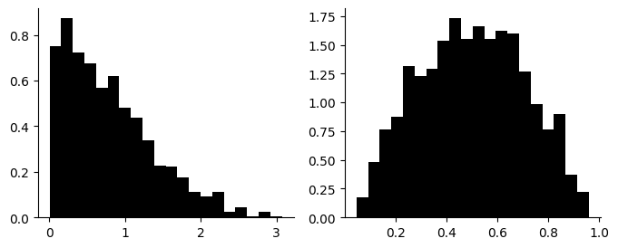
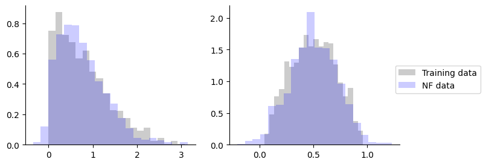
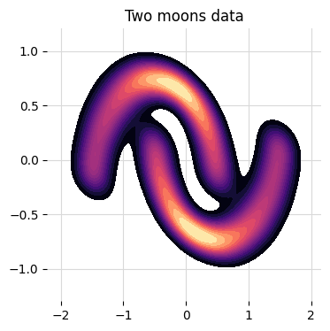
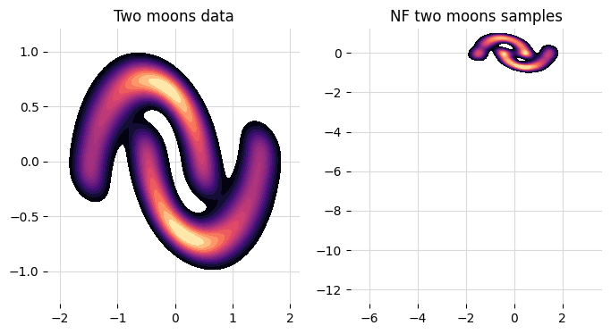
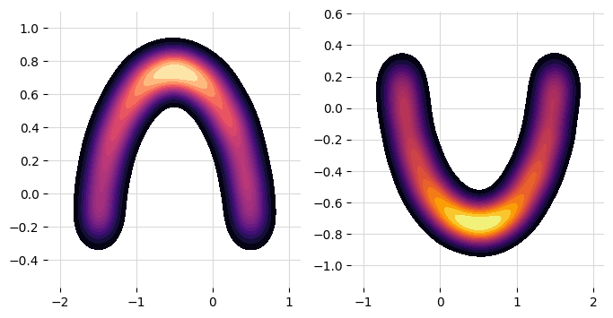
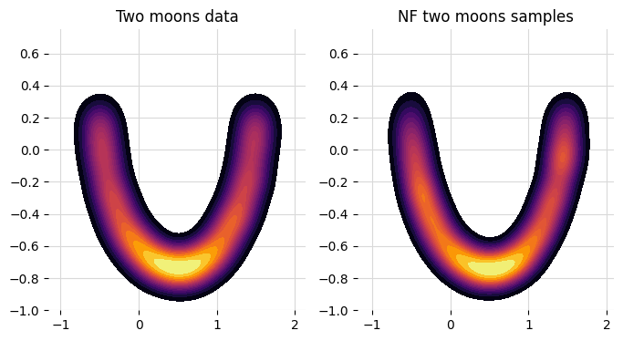

# Examples

Worked examples for `surjectors`, adapted from the project tutorials. Each is a self-contained walkthrough you can paste into a script or notebook. For runnable command-line scripts, see the [`examples/`](examples) directory.

## Contents

- [An introduction to Surjectors](#an-introduction-to-surjectors)
- [Unconditional and conditional density estimation](#unconditional-and-conditional-density-estimation)
- [Dimensionality reduction with surjections](#dimensionality-reduction-with-surjections)

---

## An introduction to Surjectors

This introductory notebook illustrates the usage of the basic functionality of `Surjectors` such as

- using [Haiku](https://github.com/google-deepmind/dm-haiku), [Distrax](https://github.com/google-deepmind/distrax) and [Optax](https://github.com/google-deepmind/optax),
- defining transformed distributions, 
- and training a normalizing flow.

At its core, `Surjector` uses Haiku to compose functions with trainable parameters, such as neural networks, and Distrax to compute probability densities and sample random variables. Hence using `Surjectors` also requires some knowledge of these two.
Below we illustrate how to use Haiku's core functionality to build pure functions and how to build normalizing flows for density estimation. You can find an interactive version here:

](https://colab.research.google.com/github/dirmeier/surjectors/blob/main/docs/notebooks/introduction.ipynb)

```python
from collections import namedtuple

import distrax
import haiku as hk
import jax
import numpy as np
import optax
from jax import jit
from jax import numpy as jnp
from jax import random as jr

import matplotlib.pyplot as plt

from surjectors import Chain, MaskedCoupling, Slice, TransformedDistribution
from surjectors.nn import make_mlp
from surjectors.util import as_batch_iterator, make_alternating_binary_mask
```

### How to construct a Haiku module

We begin by demonstrating how to construct a normalizing flow using Haiku modules. A more torough introduction to Haiku can be found [here](https://dm-haiku.readthedocs.io/en/latest/). We start with some code, before we explain what it does.

```python
def make_flow(n_dimensions):
    def flow(**kwargs):
        def decoder_fn(n_dim):
            def _fn(z):
                params = make_mlp([4, n_dim * 2])(z)
                means, log_scales = jnp.split(params, 2, -1)
                return distrax.Independent(
                    distrax.Normal(means, jnp.exp(log_scales)),
                    reinterpreted_batch_ndims=1,
                )

            return _fn

        transform = Slice(n_dimensions // 2, decoder_fn(n_dimensions // 2))
        base_distribution = distrax.Independent(
            distrax.Normal(
                jnp.zeros(n_dimensions // 2), jnp.ones(n_dimensions // 2)
            ),
            reinterpreted_batch_ndims=1,
        )
        pushforward = TransformedDistribution(base_distribution, transform)
        return pushforward(**kwargs)

    td = hk.transform(flow)
    return td
```

This example uses a `Slice` surjector to reduce the dimensionality of some data by a factor of two: ` Slice(n_dimensions // 2, decoder_fn(n_dimensions // 2))`.

Constructing a Haiku module needs to be done within a `hk.transform` block. This can either be done by providing a function like here and an object. In our case we are using `hk.transform` on `pushforward(**kwargs)` which calls
the `__call__` method of `TransformedDistribution`. Since we are generally interested to use *all* functions of a `TransformedDistribution`, e.g., `sample` and `log_prob`, the `__call__` function is implemented to dispatch on a method based on what is provided in `**kwargs`. More on that later (see the Section below).

We can now initialize the module. With Haiku, we first initialize trainable parameters using `fn.init`.

```python
rng_key_seq = hk.PRNGSequence(0)

n, p = 1000, 10
y = jr.normal(next(rng_key_seq), (n, p))

fn = make_flow(p)
params = fn.init(next(rng_key_seq), method="log_prob", y=y)
params
```

The only trainable paramaters that are flow defines are the weights of the MLP. The MLP is used to compute the conditional probability density inside the `decoder_fn` function. 
The `Slice` surjector itself doesn't have parameters. We can now test the flow. Let's sample some data first.

```python
samples = fn.apply(
    params, next(rng_key_seq), method="sample", sample_shape=(2,)
)
samples
```

As mentioned above, in order to dispatch to a method, we just provide a keyword argument. In this case this is `method='sample'`. Computing the log probability of the data can be done by changing the method argument to `log_prob`.

```python
fn.apply(params, next(rng_key_seq), method="log_prob", y=samples)
```

### Working with Haiku modules

Haiku's `hk.transform` transforms a function or object into a pure function `fn` that can be used with `jax.vmap` or `jax.pmap` and which can be called using `fn.apply`. When calling `fn.apply` the `__call__` method of the original object is called. Unfortunately, this means that there is only one entry point to an object (i.e., `__call__`) and there is (afaict) no direct way to call member functions of a class. As a remedy, all classes that `Surjector` exposes implement a `__call__` that can be used to call all other functions.

What does that mean exactly? Consider again the transformed distribution object from above:

```
TransformedDistribution(base_distribution, transform)
```

When transforming this object

```
fn = hk.transform(lambda x: TransformedDistribution(base_distribution, transform)(y))
```

and then calling its pure function transformation

```
fn.apply(None, None, y)
```

Haiku calls `TransformedDistribution.__call__(y)`. In order to have access to all other member functions, which in this case are

- `sample`
- `log_prob`
- `sample_and_log_prob`
- `inverse_and_log_prob`


we implemented `__call__` with the following signature and method body:

```
def __call__(self, method, **kwargs):       
    return getattr(self, method)(**kwargs)
```

This allows dispatching to every member function a class has. Concretely, we would call 

```
fn.apply(params, rng_key, method="log_prob", y=y)
```

when we want to call `TransformedDistribution.log_prob(y)`.

**Information of which methods classes implement can be found in the API documentation.**

### How to construct `TransformedDistribution` objects

The `TransformedDistribution` class takes a base distribution and a transformation that maps a sample from the base distribution to the distribution that is induced by the transformation. It's important to note that the dimensionality of the base distribution needs to have the same cardinality as the result of applying a transform on a data point. For instance, consider the transform below where we again use a `Slice` surjector.

```python
def make_transform(n_dimensions):
    def transform(**kwargs):
        def decoder_fn(n_dim):
            def fn(z):
                params = make_mlp([4, n_dim * 2])(z)
                means, log_scales = jnp.split(params, 2, -1)
                return distrax.Independent(
                    distrax.Normal(means, jnp.exp(log_scales)),
                    reinterpreted_batch_ndims=1,
                )

            return fn

        slic = Slice(n_dimensions // 2, decoder_fn(n_dimensions // 2))
        return slic(**kwargs)

    td = hk.transform(transform)
    return td
```

The transform above defines a simple parameterized transformation and not a pushforward measure (in which we are typically interested in when working with flows).
Depending on the `method` argument, it reduces the dimensionality of the input or increases it.

```python
rng_key_seq = hk.PRNGSequence(0)

n, p = 1000, 10
y = jr.normal(next(rng_key_seq), (n, p))

transform = make_transform(p)
params = transform.init(next(rng_key_seq), method="inverse", y=y)

z = transform.apply(params, next(rng_key_seq), method="inverse", y=y)
z.shape
```

The *forward* transformation takes as an argument a variable $Z$ from the latent space:

```python
y_hat = transform.apply(params, next(rng_key_seq), method="forward", z=z)
y_hat.shape
```

When defining a normalizing flow, it assumes that the transformation is the **inverse** mapping, i.e., the mapping from data to latent space. Hence the transform $f$ is defined $f: \mathcal{Y} \rightarrow \mathcal{Z}$ (technically this means that
`TransformedDistribution` defines the pullback).

With this, we can now define a `TransformedDistribution`. A transformed distribution is defined by 

- a base measure `base_distribution`,
- and a transform `transform`.

For instance, again as a Haiku module:

```python
def make_flow(n_dimensions):
    def flow(**kwargs):
        def decoder_fn(n_dim):
            def fn(z):
                params = make_mlp([64, 64, n_dim * 2])(z)
                means, log_scales = jnp.split(params, 2, -1)
                return distrax.Independent(
                    distrax.Normal(means, jnp.exp(log_scales)),
                    reinterpreted_batch_ndims=1,
                )

            return fn

        transform = Slice(n_dimensions // 2, decoder_fn(n_dimensions // 2))
        base_distribution = distrax.Independent(
            distrax.Normal(
                jnp.zeros(n_dimensions // 2), jnp.ones(n_dimensions // 2)
            ),
            reinterpreted_batch_ndims=1,
        )
        pushforward = TransformedDistribution(base_distribution, transform)
        return pushforward(**kwargs)

    td = hk.transform(flow)
    return td
```

Initialize and apply the flow:

```python
rng_key_seq = hk.PRNGSequence(0)

n, p = 1000, 100
y = jr.normal(next(rng_key_seq), (n, p))

fn = make_flow(p)
params = fn.init(next(rng_key_seq), method="log_prob", y=y)

lps = fn.apply(params, next(rng_key_seq), method="log_prob", y=y)
samples = fn.apply(
    params, next(rng_key_seq), method="sample", sample_shape=(10,)
)
```

### Training a normalizing flow

We are now set up to actually train the parameters of the flow which we do using the gradient-transformation library Optax. The code excerpt below can be used for training any flow in `Surjectors` (with some minor modifications).

```python
def train(rng_key, data, model, n_iter=1000):
    # convert the data set to an iterator
    batch_key, rng_key = jr.split(rng_key)
    train_iter = as_batch_iterator(batch_key, data, 100, True)

    # initialize the model
    init_key, rng_key = jr.split(rng_key)
    params = model.init(init_key, method="log_prob", **train_iter(0))

    # create an optimizer
    optimizer = optax.adam(1e-4)
    state = optimizer.init(params)

    @jit
    # gradient step
    def step(params, state, **batch):
        def loss_fn(params):
            lp = model.apply(params, None, method="log_prob", **batch)
            return -jnp.mean(lp)

        loss, grads = jax.value_and_grad(loss_fn)(params)
        updates, new_state = optimizer.update(grads, state, params)
        new_params = optax.apply_updates(params, updates)
        return loss, new_params, new_state

    losses = np.zeros(n_iter)
    # training loop
    for i in range(n_iter):
        train_loss = 0.0
        # iterate over batches
        for j in range(train_iter.num_batches):
            batch = train_iter(j)
            batch_loss, params, state = step(params, state, **batch)
            train_loss += batch_loss
        losses[i] = train_loss

    return params, losses
```

Let's test this to train a flow on a simple two-dimensional data set.

```python
n, p = 1000, 2
z = jr.normal(next(rng_key_seq), (n, p))
y = jnp.vstack([jnp.abs(z[:, 0]), jax.nn.sigmoid(z[:, 1])]).T
```

```python
_, axes = plt.subplots(figsize=(8, 3), ncols=2)
for i, ax in enumerate(axes):
    ax.hist(y[:, i], color="black", density=True, bins=20)
    ax.spines["top"].set_visible(False)
    ax.spines["right"].set_visible(False)
plt.show()
```



We use a masked coupling bijector with affine transformations. Specifically, we use five masked coupling layers that we concatenate using the `Chain` operator.

```python
def make_flow(n_dimensions):
    def flow(**kwargs):
        def bijector_fn(params):
            means, log_scales = jnp.split(params, 2, -1)
            return distrax.ScalarAffine(means, jnp.exp(log_scales))

        layers = []
        for i in range(5):
            layer = MaskedCoupling(
                mask=make_alternating_binary_mask(n_dimensions, i % 2 == 0),
                bijector_fn=bijector_fn,
                conditioner=make_mlp([32, 32, n_dimensions * 2]),
            )
            layers.append(layer)

        transform = Chain(layers)
        base_distribution = distrax.Independent(
            distrax.Normal(jnp.zeros(n_dimensions), jnp.ones(n_dimensions)),
            reinterpreted_batch_ndims=1,
        )
        pushforward = TransformedDistribution(base_distribution, transform)

        return pushforward(**kwargs)

    td = hk.transform(flow)
    return td
```

To train the flow we need to provide a data argument for `as_batch_iterator` which has to be a named tuple. If the tuple has one element, called `y`, an unconditional flow is trained. If a tuple with two elements, called `y` and `x`, is provided, a conditional flow is trained.

```python
fn = make_flow(p)
data = namedtuple("named_dataset", "y")(y)
params, losses = train(next(rng_key_seq), data, fn)
```

That's it. Let's draw some sampels.

```python
samples = fn.apply(
    params, next(rng_key_seq), method="sample", sample_shape=(1000,)
)
```

```python
_, axes = plt.subplots(figsize=(8, 3), ncols=2)
for i, ax in enumerate(axes):
    ax.hist(
        y[:, i],
        color="black",
        density=True,
        bins=20,
        alpha=0.2,
        label="Training data",
    )
    ax.hist(
        samples[:, i],
        color="blue",
        density=True,
        bins=20,
        alpha=0.2,
        label="NF data",
    )
    ax.spines["top"].set_visible(False)
    ax.spines["right"].set_visible(False)
plt.legend(loc="upper right", bbox_to_anchor=(1.5, 0.6))
plt.show()
```



### References

[1] Klein, Samuel, et al. "Funnels: Exact maximum likelihood with dimensionality reduction". Workshop on Bayesian Deep Learning, Advances in Neural Information Processing Systems, 2021.

[2] Durkan, Conor, et al. "Neural Spline Flows". Advances in Neural Information Processing Systems, 2019.

[3] Papamakarios, George, et al. "Masked Autoregressive Flow for Density Estimation". Advances in Neural Information Processing Systems, 2017.

---

## Unconditional and conditional density estimation

Normalizing flows are generative models that utilize multiple parameterized transformations to create expressive probabilty density functions which can be evaluated exactly. In this notebook, we demonstrate unconditional and conditional normalizing flow training on the two moons data set.

](https://colab.research.google.com/github/dirmeier/surjectors/blob/main/docs/notebooks/normalizing_flows.ipynb)

```python
import distrax
import haiku as hk
import jax
import numpy as np
import optax

from collections import namedtuple

import matplotlib.pyplot as plt
import seaborn as sns
from jax import jit
from jax import numpy as jnp
from jax import random as jr
from sklearn import cluster, datasets, mixture
from sklearn.preprocessing import StandardScaler
from tqdm import tqdm

from surjectors import (
    Chain,
    MaskedAutoregressive,
    MaskedCoupling,
    Permutation,
    TransformedDistribution,
)
from surjectors.nn import MADE, make_mlp
from surjectors.util import (
    as_batch_iterator,
    make_alternating_binary_mask,
    unstack,
)
```

We define a training function first that we can use for all density estimation tasks below.

```python
def train(rng_key, data, model, n_iter=1000):
    # convert the data set to an iterator
    batch_key, rng_key = jr.split(rng_key)
    train_iter = as_batch_iterator(batch_key, data, 100, True)

    # initialize the model
    init_key, rng_key = jr.split(rng_key)
    params = model.init(init_key, method="log_prob", **train_iter(0))

    # create an optimizer
    optimizer = optax.adam(1e-4)
    state = optimizer.init(params)

    @jit
    # gradient step
    def step(params, state, **batch):
        def loss_fn(params):
            lp = model.apply(params, None, method="log_prob", **batch)
            return -jnp.mean(lp)

        loss, grads = jax.value_and_grad(loss_fn)(params)
        updates, new_state = optimizer.update(grads, state, params)
        new_params = optax.apply_updates(params, updates)
        return loss, new_params, new_state

    losses = np.zeros(n_iter)
    # training loop
    for i in tqdm(range(n_iter)):
        train_loss = 0.0
        # iterate over batches
        for j in range(train_iter.num_batches):
            batch = train_iter(j)
            batch_loss, params, state = step(params, state, **batch)
            train_loss += batch_loss
        losses[i] = train_loss

    return params, losses
```

### Unconditional normalizing flows

Let's illustrate using an masked autoregressive bijector for unconditional density estimation on the two moons data. A sample is shown below.

```python
n = 10000
y, _ = datasets.make_moons(n_samples=n, noise=0.05)
y = StandardScaler(with_std=False).fit_transform(y)
```

```python
_, ax = plt.subplots(figsize=(4, 4))
ax = sns.kdeplot(
    x=y[:, 0], y=y[:, 1], cmap="magma", fill=True, levels=20, zorder=2, ax=ax
)
for side in ["top", "right", "left", "bottom"]:
    ax.spines[side].set_visible(False)
ax.grid(axis="both", color="0.85", zorder=1)
ax.set_title("Two moons data")
plt.show()
```



We define a flow that consists of five layers of masked autoregressive flows (MAFs). Each flow takes a conditioner and an inner bijector function. The conditioner for MAFs is a MADE network for which we can use the `MADE` class.
The inner bijector can be anything, for instance, an RQ-NSF or an affine transformation.

```python
def make_flow(n_dimensions):
    def flow(**kwargs):
        def bijector_fn(params):
            means, log_scales = unstack(params, -1)
            return distrax.Inverse(
                distrax.ScalarAffine(means, jnp.exp(log_scales))
            )

        layers = []
        order = jnp.arange(n_dimensions)
        for i in range(5):
            layer = MaskedAutoregressive(
                conditioner=MADE(n_dimensions, [128, 128], 2),
                bijector_fn=bijector_fn,
            )
            order = order[::-1]
            layers.append(layer)
            layers.append(Permutation(order, 1))

        transform = Chain(layers)
        base_distribution = distrax.Independent(
            distrax.Normal(jnp.zeros(n_dimensions), jnp.ones(n_dimensions)),
            reinterpreted_batch_ndims=1,
        )
        pushforward = TransformedDistribution(base_distribution, transform)

        return pushforward(**kwargs)

    td = hk.transform(flow)
    return td
```

This defines the entire flow. We can now train it and sample some data from the trained model.

```python
rng_key_seq = hk.PRNGSequence(0)
fn = make_flow(2)
data = namedtuple("named_dataset", "y")(y)
params, losses = train(next(rng_key_seq), data, fn)
```

```python
samples = fn.apply(
    params, next(rng_key_seq), method="sample", sample_shape=(10000,)
)
```

```python
_, axes = plt.subplots(figsize=(8, 4), ncols=2)
ax = sns.kdeplot(
    x=y[:, 0],
    y=y[:, 1],
    cmap="magma",
    fill=True,
    levels=20,
    zorder=2,
    ax=axes[0],
)
ax = sns.kdeplot(
    x=samples[:, 0],
    y=samples[:, 1],
    cmap="magma",
    fill=True,
    levels=20,
    zorder=2,
    ax=axes[1],
)
for ax, title in zip(axes, ["Two moons data", "NF two moons samples"]):
    ax.set_title(title)
    ax.grid(axis="both", color="0.85", zorder=1)
    for side in ["top", "right", "left", "bottom"]:
        ax.spines[side].set_visible(False)
plt.show()
```



### Conditional normalizing flows

We can use the two moons data set for conditional density estimation using the generated labels as conditioning variables. A conditional flow example is shown below. This time we use a masked coupling flow.

```python
n = 10000
y, labels = datasets.make_moons(n_samples=n, noise=0.05)
y = StandardScaler(with_std=False).fit_transform(y)
```

```python
np.unique(labels)
```

The downward looking moon is labelled with 0 and the upward looking moon with 1.

```python
_, axes = plt.subplots(figsize=(8, 4), ncols=2)
ax = sns.kdeplot(
    x=y[labels == 0, 0],
    y=y[labels == 0, 1],
    cmap="magma",
    fill=True,
    levels=20,
    zorder=2,
    ax=axes[0],
)
ax = sns.kdeplot(
    x=y[labels == 1, 0],
    y=y[labels == 1, 1],
    cmap="inferno",
    fill=True,
    levels=20,
    zorder=2,
    ax=axes[1],
)
for ax in axes:
    ax.grid(axis="both", color="0.85", zorder=1)
    for side in ["top", "right", "left", "bottom"]:
        ax.spines[side].set_visible(False)
ax.grid(axis="both", color="0.85", zorder=1)
plt.show()
```



The definition of conditional flow is *exactly the same* as in the unconditional case. For a bit of variety, we use a masked coupling flow though. One advantage of the coupling flow is that we don't need to have a specific conditioner, but
any MLP will do. One disadvantage is that it is generally a bit less flexible.

```python
def make_flow(n_dimensions):
    def flow(**kwargs):
        def bijector_fn(params):
            means, log_scales = jnp.split(params, 2, -1)
            return distrax.Inverse(
                distrax.ScalarAffine(means, jnp.exp(log_scales))
            )

        layers = []
        for i in range(5):
            layer = MaskedCoupling(
                mask=make_alternating_binary_mask(n_dimensions, i % 2 == 0),
                conditioner=make_mlp([128, 128, 2 * n_dimensions]),
                bijector_fn=bijector_fn,
            )
            layers.append(layer)

        transform = Chain(layers)
        base_distribution = distrax.Independent(
            distrax.Normal(jnp.zeros(n_dimensions), jnp.ones(n_dimensions)),
            reinterpreted_batch_ndims=1,
        )
        pushforward = TransformedDistribution(base_distribution, transform)

        return pushforward(**kwargs)

    td = hk.transform(flow)
    return td
```

When training a conditional model, the provided **data set needs to contain the conditioning variable** (duh!). Conditioning variables always need to be labelled *x* while modelled variables are always labeled *y*. Apart from this, there
is no distinction between training an unconditional and a conditional model if we use the training function from above.

```python
rng_key_seq = hk.PRNGSequence(0)
fn = make_flow(2)
data = namedtuple("named_dataset", "y x")(y, labels.reshape(-1, 1))
params, losses = train(next(rng_key_seq), data, fn)
```

Let's sample only data for which the label is 1, i.e., the upward looking moon of the two moons data set.

```python
samples = fn.apply(
    params, next(rng_key_seq), method="sample", x=jnp.ones((10000, 1))
)
```

```python
_, axes = plt.subplots(figsize=(8, 4), ncols=2)
ax = sns.kdeplot(
    x=y[labels == 1, 0],
    y=y[labels == 1, 1],
    cmap="inferno",
    fill=True,
    levels=20,
    zorder=2,
    ax=axes[0],
)
ax = sns.kdeplot(
    x=samples[:, 0],
    y=samples[:, 1],
    cmap="inferno",
    fill=True,
    levels=20,
    zorder=2,
    ax=axes[1],
)
for ax, title in zip(axes, ["Two moons data", "NF two moons samples"]):
    ax.set_title(title)
    ax.grid(axis="both", color="0.85", zorder=1)
    for side in ["top", "right", "left", "bottom"]:
        ax.spines[side].set_visible(False)
    ax.set_ylim(-1.0, 0.75)
plt.show()
```



### References

[1] Dinh, Laurent, et al. "Density estimation using RealNVP". International Conference on Learning Representations, 2017.

[2] Papamakarios, George, et al. "Masked Autoregressive Flow for Density Estimation". Advances in Neural Information Processing Systems, 2017.

---

## Dimensionality reduction with surjections

Surjective normalizing flows use dimensionality-reducing transformations instead of dimensionality-preserving bijective ones. 
Below we implement several surjective normalizing for a density estimation problem and compare them to a conventional bijective flow.

](https://colab.research.google.com/github/dirmeier/surjectors/blob/main/docs/notebooks/dimension_reduction.ipynb)

```python
import distrax
import haiku as hk
import jax
import numpy as np
import optax
import pandas as pd

from collections import namedtuple
from jax import jit
from jax import numpy as jnp
from jax import random as jr
from tqdm import tqdm

from surjectors import (
    Chain,
    LULinear,
    MaskedCoupling,
    MaskedCouplingInferenceFunnel,
    MLPInferenceFunnel,
    TransformedDistribution,
)
from surjectors.nn import make_mlp
from surjectors.util import (
    as_batch_iterator,
    make_alternating_binary_mask,
)
```

We define a training function first that we can use for all density estimation tasks below.

```python
def train(rng_key, data, model, n_iter=1000):
    # convert the data set to an iterator
    batch_key, rng_key = jr.split(rng_key)
    train_iter = as_batch_iterator(batch_key, data, 100, True)

    # initialize the model
    init_key, rng_key = jr.split(rng_key)
    params = model.init(init_key, method="log_prob", **train_iter(0))

    # create an optimizer
    optimizer = optax.adam(1e-4)
    state = optimizer.init(params)

    @jit
    # gradient step
    def step(params, state, **batch):
        def loss_fn(params):
            lp = model.apply(params, None, method="log_prob", **batch)
            return -jnp.mean(lp)

        loss, grads = jax.value_and_grad(loss_fn)(params)
        updates, new_state = optimizer.update(grads, state, params)
        new_params = optax.apply_updates(params, updates)
        return loss, new_params, new_state

    losses = np.zeros(n_iter)
    # training loop
    for i in tqdm(range(n_iter)):
        train_loss = 0.0
        # iterate over batches
        for j in range(train_iter.num_batches):
            batch = train_iter(j)
            batch_loss, params, state = step(params, state, **batch)
            train_loss += batch_loss
        losses[i] = train_loss

    return params, losses
```

### Data

We simulate data from a factor model for testing. The data can should easily embedded in a lower dimensional space via a linear transformation.

```python
rng_key_seq = hk.PRNGSequence(0)
```

```python
n_train, n_test = 1000, 200
n = n_train + n_test
p_data, p_latent = 20, 5

z = jr.normal(next(rng_key_seq), (n, p_latent))
W = jr.normal(next(rng_key_seq), (p_data, p_latent)) * 0.1
y = (W @ z.T).T + jr.normal(next(rng_key_seq), (n, p_data)) * 0.1
```

### A bijective baseline

We start with a simple baseline: a masked coupling flow with rational quadratic splines as transforms. The data is not dimensionality-reducing and hence tries to estimate the density on the $20$-dimensional space.

A RQ splince flow requires defining ranges for which we use the lower and upper bounds of the data

```python
range_min, range_max = float(np.min(y)), float(np.max(y))
```

Next we define the conditioner function.

```python
def make_rq_conditioner(event_shape, hidden_sizes, n_bins):
    n_params = 3 * n_bins + 1
    return hk.Sequential(
        [
            make_mlp(hidden_sizes + [event_shape * n_params]),
            hk.Reshape((event_shape,) + (n_params,), preserve_dims=-1),
        ]
    )
```

We create a baseine that uses five masked coupling flows.

```python
def make_baseline(n_dimensions):
    def flow(**kwargs):
        def bijector_fn(params):
            return distrax.RationalQuadraticSpline(
                params, range_min=range_min, range_max=range_max
            )

        layers = []
        for i in range(5):
            layer = MaskedCoupling(
                mask=make_alternating_binary_mask(n_dimensions, i % 2 == 0),
                conditioner=make_rq_conditioner(n_dimensions, [128, 128], 4),
                bijector_fn=bijector_fn,
            )
            layers.append(layer)

        transform = Chain(layers)
        base_distribution = distrax.Independent(
            distrax.Normal(jnp.zeros(n_dimensions), jnp.ones(n_dimensions)),
            reinterpreted_batch_ndims=1,
        )
        pushforward = TransformedDistribution(base_distribution, transform)

        return pushforward(**kwargs)

    td = hk.transform(flow)
    return td
```

Training of the baseline is done as follows:

```python
baseline = make_baseline(p_data)
data = namedtuple("named_dataset", "y")(y[:n_train])
params_baseline, _ = train(next(rng_key_seq), data, baseline)
```

### A surjective MLP funnel

As a first surjective flow, we implement a `MLPInferenceFunnel`. The surjection uses a LU decomposition as inner bijector and a conditional probability density parameterized by an MLP as a decoder. We again use a flow of five layers. The first two and the last two are dimensionality-preserving `LULinear` bijections. The layer in the middle is a dimensionality-reducing funnel.

```python
def make_surjective_mlp_funnel(n_dimensions):
    def flow(**kwargs):
        def decoder_fn(n_dim):
            def fn(z):
                params = make_mlp([32, 32, n_dim * 2])(z)
                mu, log_scale = jnp.split(params, 2, -1)
                return distrax.Independent(
                    distrax.Normal(mu, jnp.exp(log_scale))
                )

            return fn

        n_dim = n_dimensions
        layers = []
        for i in range(5):
            if i == 2:
                layer = MLPInferenceFunnel(
                    n_keep=int(n_dim / 2), decoder=decoder_fn(int(n_dim / 2))
                )
                n_dim = int(n_dim / 2)
            else:
                layer = LULinear(n_dim)
            layers.append(layer)

        transform = Chain(layers)
        base_distribution = distrax.Independent(
            distrax.Normal(jnp.zeros(n_dim), jnp.ones(n_dim)),
            reinterpreted_batch_ndims=1,
        )
        pushforward = TransformedDistribution(base_distribution, transform)
        return pushforward(**kwargs)

    td = hk.transform(flow)
    return td
```

```python
surjective_mlp_funnel = make_surjective_mlp_funnel(p_data)
data = namedtuple("named_dataset", "y")(y[:n_train])
params_surjective_mlp_funnel, _ = train(
    next(rng_key_seq), data, surjective_mlp_funnel
)
```

### A surjective affine masked coupling flow

As a second surjector, we implement a `MaskedCouplingInferenceFunnel` with affine transformations. The surjection uses an affine masked coupling layer as inner bijector and a conditional probability density parameterized by an MLP as a decoder. We use the surjection in the middle of five flow layers. The other four are conventional masked coupling flows.

```python
def make_surjective_affine_masked_coupling(n_dimensions):
    def flow(**kwargs):
        def bijector_fn(params):
            means, log_scales = jnp.split(params, 2, -1)
            return distrax.ScalarAffine(means, jnp.exp(log_scales))

        def decoder_fn(n_dim):
            def fn(z):
                params = make_mlp([32, 32, n_dim * 2])(z)
                mu, log_scale = jnp.split(params, 2, -1)
                return distrax.Independent(
                    distrax.Normal(mu, jnp.exp(log_scale))
                )

            return fn

        n_dim = n_dimensions
        layers = []
        for i in range(5):
            if i == 2:
                layer = MaskedCouplingInferenceFunnel(
                    n_keep=int(n_dim / 2),
                    decoder=decoder_fn(int(n_dim / 2)),
                    conditioner=make_mlp([128, 128, 2 * n_dim]),
                    bijector_fn=bijector_fn,
                )
                n_dim = int(n_dim / 2)
            else:
                layer = MaskedCoupling(
                    mask=make_alternating_binary_mask(n_dim, i % 2 == 0),
                    conditioner=make_mlp([128, 128, 2 * n_dim]),
                    bijector_fn=bijector_fn,
                )
            layers.append(layer)

        transform = Chain(layers)
        base_distribution = distrax.Independent(
            distrax.Normal(jnp.zeros(n_dim), jnp.ones(n_dim)),
            reinterpreted_batch_ndims=1,
        )
        pushforward = TransformedDistribution(base_distribution, transform)
        return pushforward(**kwargs)

    td = hk.transform(flow)
    return td
```

```python
surjective_affine_masked_coupling = make_surjective_affine_masked_coupling(
    p_data
)
data = namedtuple("named_dataset", "y")(y[:n_train])
params_surjective_affine_masked_coupling, _ = train(
    next(rng_key_seq), data, surjective_affine_masked_coupling
)
```

### A surjective rational quadratic masked coupling flow

Finally, we implement a `MaskedCouplingInferenceFunnel` with a rational quadratic transformations. The flow is the same as before, but with affine transformations replaced with splines.

```python
def make_surjective_rq_masked_coupling(n_dimensions):
    def flow(**kwargs):
        def bijector_fn(params):
            return distrax.RationalQuadraticSpline(
                params, range_min=range_min, range_max=range_max
            )

        def decoder_fn(n_dim):
            def fn(z):
                params = make_mlp([32, 32, n_dim * 2])(z)
                mu, log_scale = jnp.split(params, 2, -1)
                return distrax.Independent(
                    distrax.Normal(mu, jnp.exp(log_scale))
                )

            return fn

        n_dim = n_dimensions
        layers = []
        for i in range(5):
            if i == 2:
                layer = MaskedCouplingInferenceFunnel(
                    n_keep=int(n_dim / 2),
                    decoder=decoder_fn(int(n_dim / 2)),
                    conditioner=make_rq_conditioner(n_dim, [128, 128], 4),
                    bijector_fn=bijector_fn,
                )
                n_dim = int(n_dim / 2)
            else:
                layer = MaskedCoupling(
                    mask=make_alternating_binary_mask(n_dim, i % 2 == 0),
                    conditioner=make_rq_conditioner(n_dim, [128, 128], 4),
                    bijector_fn=bijector_fn,
                )
            layers.append(layer)

        transform = Chain(layers)
        base_distribution = distrax.Independent(
            distrax.Normal(jnp.zeros(n_dim), jnp.ones(n_dim)),
            reinterpreted_batch_ndims=1,
        )
        pushforward = TransformedDistribution(base_distribution, transform)
        return pushforward(**kwargs)

    td = hk.transform(flow)
    return td
```

```python
surjective_rq_masked_coupling = make_surjective_rq_masked_coupling(p_data)
data = namedtuple("named_dataset", "y")(y[:n_train])
params_surjective_rq_masked_coupling, _ = train(
    next(rng_key_seq), data, surjective_rq_masked_coupling
)
```

### Density comparisons

Having trained the baseline and surjectors, let’s compute density estimates of the training and test data sets using the four models.

```python
model_list = [
    baseline,
    surjective_mlp_funnel,
    surjective_affine_masked_coupling,
    surjective_rq_masked_coupling,
]

param_list = [
    params_baseline,
    params_surjective_mlp_funnel,
    params_surjective_affine_masked_coupling,
    params_surjective_rq_masked_coupling,
]

lps = []
for model, params in zip(model_list, param_list):
    lp_training = model.apply(params, None, method="log_prob", y=y[:n_train])
    lp_test = model.apply(params, None, method="log_prob", y=y[n_train:])
    lp_training = jnp.mean(lp_training)
    lp_test = jnp.mean(lp_test)
    lps.append(np.array([lp_training, lp_test]))
```

Not so surprisingly the MLP funnel works best on this data set. The baseline that does not reduce dimensionality has the worst performance.

```python
df = pd.DataFrame(lps, columns=["Training density", "Test density"])
df.insert(
    0,
    "Model",
    [
        "Baseline",
        "MLP funnel",
        "Affine masked coupling funnel",
        "RQ masked coupling funnel",
    ],
)
df
```

### References

[1] Klein, Samuel, et al. "Funnels: Exact maximum likelihood with dimensionality reduction". Workshop on Bayesian Deep Learning, Advances in Neural Information Processing Systems, 2021.
